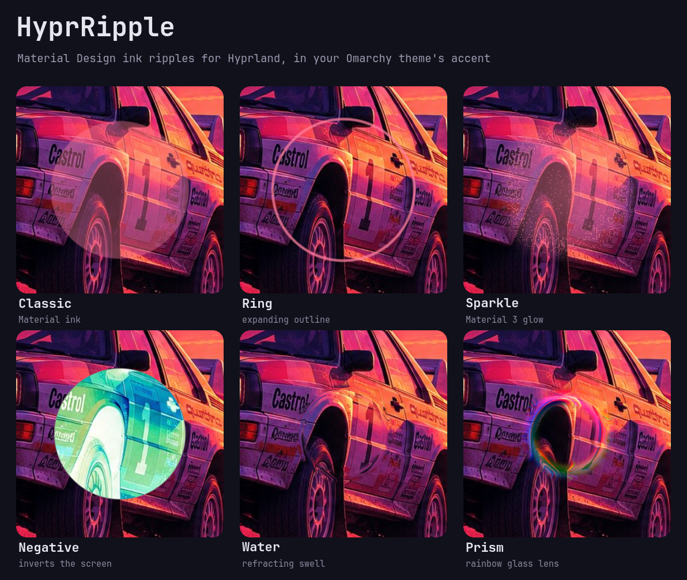

# HyprRipple

Material Design ink ripples for Hyprland, drawn by the compositor itself in
your Omarchy theme's accent colour. Click, tap, change focus or switch
workspace and the screen answers with a ripple. It can be a classic splash, a
Material 3 sparkle, or an effect on the screen itself: inverted, refracted
like water, or bent through a rainbow lens.



## Install

**On Omarchy** (gets you the settings panel and menu entries too):

```sh
omarchy plugin add <repo-url> --enable
~/.config/omarchy/plugins/jgarza.hyprripple/install
```

**On plain Hyprland** (the native plugin only, set up through Lua):

```sh
git clone <repo-url> hyprripple && cd hyprripple
./install --no-menu
```

`./install` does everything, and it's safe to run again (it also upgrades).
It:

1. builds the native plugin with `hyprpm` and enables it (hyprpm may ask for
   your password)
2. creates `~/.config/hypr/hyprripple.lua` with default settings, keeping
   yours if it already exists
3. adds `require("hypr.hyprripple")` to `~/.config/hypr/hyprland.lua`
4. on Omarchy, adds **HyprRipple** to the menu (search "ripple", or
   **Style → HyprRipple**) and enables the settings panel

Every file it edits is backed up first (`<file>.bak.hyprripple.<time>`), and
its edits are fenced with `>>> hyprripple >>>` comments.
`./install --dry-run` shows what it would do without changing anything.

**Requirements:** Hyprland 0.56+ with the Lua config, plus `hyprpm`, `git`,
`make`, `g++`, `pkg-config` and `python3`. Omarchy is optional: without it
you get the ripples and Lua settings but not the panel, menu entries or
theme colours (the colour falls back to blue).

### Update

```sh
git pull && ./install
```

Hyprland plugins must match the exact Hyprland build. After a Hyprland
update, run `hyprpm update` (or `./install`). HyprRipple sends you a
notification when it needs this.

### Uninstall

```sh
./uninstall            # keeps your settings
./uninstall --purge    # also deletes hyprripple.lua and per-preset memory
```

It removes exactly what `./install` added: the require line, the menu
entries, the shell plugin and the hyprpm plugin. Your other config is left as
it was.

## Using it

Open the settings from the Omarchy menu (search **ripple**), or with
`omarchy-shell shell toggle jgarza.hyprripple`. Everything changes live. The
panel has four sections:

- **Triggers:** mouse clicks (left or any button), touch & pen, window focus,
  hover focus, workspace switch
- **Look:** colour, preset, opacity, radius, edge softness, plus
  per-preset extras (ring width, sparkle amount, distortion)
- **Motion:** grow-while-held, duration, focus origin, clip to window,
  workspace radius, max ripples
- **Exclude:** skip fullscreen, pause while screen sharing, excluded apps

**Keys:**

| Key | Action |
|---|---|
| Tab | switch section |
| ↑↓ / j k | move between rows |
| ←→ / h l | change the value |
| Enter / Space | toggle, or edit a text field |
| Backspace | reset the row to its default |
| T | test ripple |
| Esc | close |

Every row shows a dot when it differs from its default, and has its own
reset button.

### Presets

| Preset | What it does |
|---|---|
| **Classic** | Material ink: a near-solid disc with a feathered rim |
| **Ring** | an expanding outline |
| **Sparkle** | Material 3 / Android 12: a soft glow with shimmering grain that trails the wave |
| **Negative** | inverts the screen under the disc |
| **Water** | one smooth swell that refracts the screen like a lens of water |
| **Prism** | a glass lens band that splits red/green/blue, with a turning rainbow |

Each preset remembers its own **opacity, radius and edge softness**: tweak
Sparkle, switch to Classic and back, and your Sparkle values return. For
Negative, Water and Prism, *opacity* is the effect's strength. Water and
Prism are travelling waves: their bend eases to zero before they fade.

### How ripples behave

- **Press and hold:** ink keeps spreading while you hold the button, finger
  or pen, and fades when you let go (up to 8 s). A quick click is a quick
  splash.
- **Clipped to the window:** ink stays inside the window you clicked, rounded
  corners included, and moves with it: drags, resizes, scrolling layouts and
  workspace slides.
- **Bars and launchers:** pressing Waybar or the Omarchy menu ripples on top
  of it, clipped to it.
- **Focus:** keyboard focus, new windows and closed windows fill the focused
  window from the cursor. Hover focus (`follow_mouse`) is off by default; when
  on, it starts at the edge the mouse came in from.
- **Workspace switch:** a wave floods the monitor from the cursor.
- **Theme colours** follow theme switches instantly.
- **Animation** runs at each monitor's own refresh rate, and costs nothing
  when no ripple is on screen.

## Settings reference

Everything lives in `~/.config/hypr/hyprripple.lua`. The panel writes it,
and hand edits apply live.

| Key | Default | |
|---|---|---|
| `enabled` | `true` | master switch |
| `on_click` | `"left"` | `none` / `left` / `any` |
| `on_touch` | `true` | touchscreen and tablet pen taps |
| `hold` | `true` | ink grows while held, fades on release |
| `on_focus` | `true` | ripple on focus change |
| `focus_hover` | `false` | also on focus-follows-mouse |
| `on_workspace` | `true` | ripple on workspace switch |
| `color` | `"accent"` | any `colors.toml` key (`accent`, `foreground`, `color4`…) or `#rrggbb[aa]` |
| `style` | `"classic"` | `classic` `ring` `sparkle` `negative` `water` `prism` |
| `opacity` | `0.28` | peak opacity (effect strength for negative/water/prism) |
| `radius` | `140` | click ripple radius, logical px |
| `softness` | `2` | edge feather, px |
| `ring_width` | `6` | ring thickness, px |
| `sparkle_amount` | `0.5` | sparkle grain, 0 to 1 |
| `distortion` | `0.5` | water/prism bend, 0 to 1 |
| `duration` | `550` | ms |
| `focus_origin` | `"cursor"` | `cursor` / `center` |
| `bounded` | `true` | clip click, tap and focus ripples to their window |
| `workspace_radius` | `"screen"` | `screen` or px |
| `max_ripples` | `16` | oldest are dropped past this |
| `skip_fullscreen` | `true` | none on a monitor showing a fullscreen window |
| `pause_when_sharing` | `false` | none while screen sharing / recording |
| `exclude` | `""` | window classes that never ripple: comma-separated, `*` `?` wildcards |

### hyprctl and Lua

```sh
hyprctl hyprripple get                     # current settings (JSON)
hyprctl hyprripple set opacity 0.2         # live, no reload
hyprctl hyprripple trigger                 # ripple at the cursor
hyprctl hyprripple trigger 800 600 200 style=water opacity=0.9
                                           # preview: styles this one ripple only;
                                           # live and saved settings don't change
hyprctl hyprripple trigger … above         # draw over bars / launchers
hyprctl hyprripple stats                   # counters, frames, live ripples
hyprctl hyprripple sharing reset           # if "pause while sharing" ever sticks
```

From Lua, for example in a keybind: `hl.plugin.hyprripple.trigger()` and
`hl.plugin.hyprripple.set("style", "prism")`.

## Troubleshooting

| Symptom | Fix |
|---|---|
| No ripples after a Hyprland update | `hyprpm update` (or `./install`) |
| Panel says "native plugin not loaded" | `hyprpm list`. If hyprripple isn't enabled, run `./install` |
| Panel looks out of date after an update | `rm -rf ~/.cache/quickshell/qmlcache/* && omarchy restart shell` |
| Ripples paused although you stopped sharing | `hyprctl hyprripple sharing reset` |
| Ripples in a game or video | turn on **Skip fullscreen**, or add the app under **Excluded apps** |

## How it works

| Part | What it is |
|---|---|
| `native/` | C++ Hyprland plugin (`hyprripple.so`). It hooks input, focus and workspace events, and draws each ripple as a render-pass element with one GLSL shader (`native/shaders/ripple.frag`). Negative/Water/Prism read a copy of the frame rendered so far. |
| `native/src/Logic.cpp` | All validation, timing, geometry and matching, kept free of Hyprland so it can be unit-tested. |
| `Panel.qml`, `SettingRow.qml`, `Model.js` | The Omarchy settings panel. |
| `Service.qml` | Background service. It keeps the plugin in sync with `hyprripple.lua`, owns per-preset memory, and warns when a rebuild is needed. |
| `install`, `uninstall`, `bin/setup.sh` | The installer. |

## Development

```sh
make                                     # build hyprripple.so
make test                                # C++ logic (ASan+UBSan), panel model, installer tests
hyprctl plugin load $PWD/hyprripple.so   # try a build (unload the hyprpm copy first)
```

hyprpm builds from the latest commit, so commit and then run `./install` to
update the installed copy.

## Security

- **Validation:** every way into the settings (hyprctl, Lua, `hyprripple.lua`,
  the panel, `presets.json`) goes through the same whitelist. Numbers are
  clamped, choices are checked, colours must be `#hex` or a theme key, and app
  globs allow only `[A-Za-z0-9._-*?, ]`. Nothing can inject into the generated
  Lua or the hyprctl batch, and JSON output is escaped.
- **Bounded work:**
  - `colors.toml` is read only if it's a regular file under 64 KiB, checked
    on the open file.
  - Wildcards are matched without regex, so a hostile pattern can't stall the
    compositor.
  - Held ripples give up after 8 s, and there are at most 64 ripples.
  - Manual triggers are rate-limited and size-capped.
- **The installer** edits only fenced blocks, backs files up first, and never
  writes a menu file that wouldn't parse.
- **Inherent to Hyprland plugins:** the plugin runs inside the compositor, and
  hyprpm builds whatever is committed here. Keep this folder writable only by
  you. `hyprctl hyprripple` is reachable by anything that can talk to
  Hyprland's socket, like the rest of `hyprctl`.

## License

MIT
